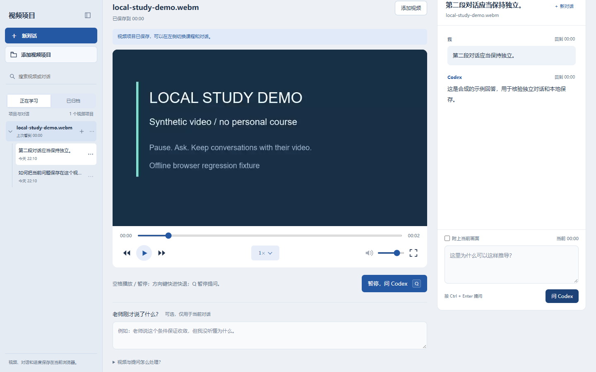

# Codex Study Player

本地课程视频播放器，当前版本 **1.4.0**。支持拖入视频、倍速滑条、快捷快进、全屏，以及通过本机已登录的 Codex CLI 在播放器旁提问。

版本仓库：[S4kuzy0/codex-study-player](https://github.com/S4kuzy0/codex-study-player)，使用 `main` 分支。原创代码采用 [MIT](LICENSE)。

每个视频是独立项目，项目内可新建、重命名、搜索和删除多个对话。视频、播放进度与对话存放在当前浏览器；复制或克隆程序目录不会复制这些数据。

## 运行

已验证环境：Windows、Windows PowerShell 5.1、Node.js 24、Chrome。浏览器需支持 IndexedDB 和所选视频编码。

1. 安装 Node.js 24 或使用 Codex 桌面应用初始化的兼容 Node.js 运行时。
2. 安装并登录可用的 Codex CLI，执行 `codex login status` 核对；提问使用该 CLI 的登录状态和账户额度。若 CLI 不在 PATH，用下文环境变量指定其可执行文件。
3. 在完整项目目录中双击 `启动播放器.cmd`。保留服务窗口。
4. 浏览器打开固定地址 <http://127.0.0.1:48731/>。拖入视频后等待保存完成。

无需安装 npm 依赖、数据库服务或填写 API Key，前端依赖随 `vendor/` 提供。也可以在项目目录执行：

```powershell
node server.mjs --open
```

`--open` 在 Windows 上自动打开浏览器；也可执行 `node server.mjs` 后手动访问页面。重复启动会复用健康的同版本服务。升级版本前先关闭旧版本的服务窗口。

## 预览



图中视频与问答为测试生成的示例，不是真实课程或模型回答。

## 使用

- 点击当前倍速弹出滑条，拖动即时调整；空格播放或暂停，方向键快进或快退，`F` 全屏，`M` 静音，`[` / `]` 调速。
- 左侧选择视频项目；“新对话”在当前视频内创建独立聊天。省略号菜单可重命名或删除，删除后短时间内可撤销。
- 视频名称旁的省略号管理整个视频：“归档视频”保留文件、进度和所有对话，移到“已归档”；在该列表可恢复到“正在学习”。归档项目不会在启动时自动续播，重新导入同一已归档视频会恢复它。
- “删除视频”须在确认窗口中再次确认，会清除该视频的浏览器副本、进度、倍速、全部关联对话、草稿、课堂补充与恢复快照。无法撤销；磁盘原文件不受影响，重新导入将建立新项目。
- 搜索支持视频名称、对话标题和消息内容。日期按北京时间显示。
- `Q` 暂停并准备提问；“老师刚才说了什么？”用于补充原话，“向 Codex 提问”填写自己的问题。`Ctrl + Enter` 发送。
- 可选择附上当前视频画面。回答中的时间按钮可返回提问位置。数学公式由本地 KaTeX 排版。

完整操作与存储说明见 [使用说明.txt](使用说明.txt)。

## 数据和模型

视频文件保存在 Dexie 管理的浏览器 IndexedDB 中，进度与倍速按视频保存。每个对话分别保存消息、草稿和课堂原话；旧版单对话记录会迁移到对应视频的初始对话。

提问会把当前问题、视频文件名、播放位置、课堂原话、当前对话最近的文字问答，以及用户选中的当前画面交给 Codex。整个视频不会上传，也没有自动音频转录。不同视频和不同对话的文字上下文分别处理。

播放器没有写死模型标识，继承 Codex CLI 对该工作目录生效的模型与推理设置。每次提问使用临时 CLI 会话，播放器历史不与 Codex 桌面的聊天自动同步。

浏览器数据与浏览器配置文件和站点地址绑定。换浏览器、换端口、清除网站数据或存储被回收，都可能导致原视频库不可见。请保留视频原文件。单独删除聊天会阻止其继续显示和进入问答上下文，旧的本地恢复快照仍保留。删除整个视频项目则清理上述恢复快照，仅保留不含问答、进度或视频内容的最小删除标记，防止旧页面写回已删数据。

## 结构和配置

| 路径 | 用途 |
| --- | --- |
| `server.mjs` | 本机 HTTP 服务、静态资源检查、Codex CLI 调用、请求校验和临时截图 |
| `app.js` | 播放控制、项目侧栏、独立对话、提问和 Markdown 显示 |
| `library.js` | Dexie 视频库、进度、对话状态、迁移及删除标记 |
| `index.html` / `style.css` | 页面结构和响应式布局 |
| `vendor/` | 随程序提供的前端库、字体和许可证 |
| `work/runtime/` | 自动生成的本机临时工作目录，Git 排除 |
| `docs/project-memory.md` | 已确认约束、设计决策和后续维护上下文 |
| `docs/verification.md` | 实际验证范围和复查命令 |

服务仅监听本机。可选环境变量均无需写进源文件：

| 变量 | 用途 |
| --- | --- |
| `STUDY_PLAYER_PORT` | 默认端口 `48731`；改变端口会改变浏览器存储所属站点 |
| `STUDY_PLAYER_RUNTIME` | 指定本机临时工作目录，默认 `work/runtime` |
| `STUDY_PLAYER_CODEX` | 指定本机 Codex CLI 可执行文件 |
| `STUDY_PLAYER_NO_REUSE` | 设置非空值时关闭已有服务复用，供调试使用 |

## 验证和故障排查

```powershell
node --check server.mjs
node --check app.js
node --check library.js
```

- 页面提示文件不完整：保留整个目录，尤其是 `vendor/`；不要只复制启动脚本。
- 移动目录后页面失效：从新位置重新运行启动脚本。服务会检查失效的旧实例并尝试恢复原地址；正在回答时会保留该请求。
- 提示旧版本仍运行：关闭旧服务窗口再启动本版本。不要为了绕过问题随意换端口。
- 无法连接 Codex：检查本机 CLI 安装和登录状态，再点页面的连接状态重试。
- 视频未保存：检查浏览器空间和持久存储权限；本次播放成功不代表文件已持久保存。

更完整的已验证和未验证范围见 [验证记录](docs/verification.md)。

## 贡献与版本维护

仅同步源码、启动文件、必要依赖资源及项目文档。`.gitignore` 排除运行目录、登录和环境配置、日志、备份、视频、压缩包，以及各级目录不同大小写的本地 agent 指令文件。第三方许可证随依赖保留。

修改后运行 `npm test`；浏览器回归、独立示例和演示截图见 [测试与演示](docs/testing.md)。提交不含真实视频、问答或登录信息。个人已部署副本的维护记录保存在 [项目记忆](docs/project-memory.md)，不作为其他使用者的安装前提。

## 第三方依赖

| 依赖 | 版本 | 许可证 | 本地许可文件 |
| --- | --- | --- | --- |
| [Dexie.js](https://github.com/dexie/Dexie.js) | 4.4.6 | Apache-2.0 | `vendor/dexie/LICENSE` |
| [KaTeX](https://github.com/KaTeX/KaTeX) | 0.16.22 | MIT | `vendor/katex/LICENSE` |
| [markdown-it](https://github.com/markdown-it/markdown-it) | 14.1.0 | MIT | `vendor/markdown-it-LICENSE.txt` |

原创代码采用 [MIT](LICENSE)，第三方代码、字体继续遵循各自许可证，汇总见 [THIRD_PARTY_NOTICES.md](THIRD_PARTY_NOTICES.md)。
